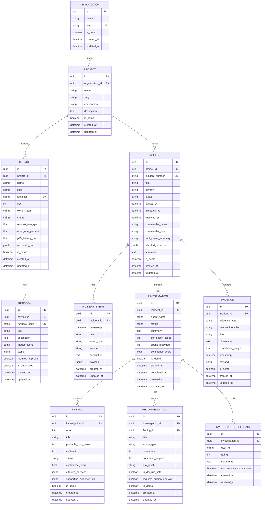

# TraceMind Database Schema Design (Phase 2.3A)

## 1. Entity-Relationship Overview
The TraceMind data model supports multi-tenant distributed systems observability, incident management, automated root cause investigations, and remediation safety.

---

## 2. Cross-Database Portability Strategy
To enable hermetic zero-network unit testing alongside high-performance PostgreSQL production deployments, TraceMind implements database abstraction types in `app/models/base.py`:

- **`GUID` Type Decorator**:
  - In PostgreSQL: Uses native binary `UUID(as_uuid=True)`.
  - In SQLite: Stores as `CHAR(36)` with automatic `uuid.UUID` coercion.
- **`JSONBCompat` Type Decorator**:
  - In PostgreSQL: Uses native binary `JSONB` for deep querying and indexing.
  - In SQLite: Stores as standard serializable `JSON` text.
- **UTC Timestamps**:
  - All timestamp fields enforce timezone awareness (`DateTime(timezone=True)`) defaulting to UTC `datetime.now(timezone.utc)`.

---

## 3. Indexing & Query Optimization
- Unique constraints on `(organization_id, slug)` for Projects and `(project_id, slug)` for Services.
- B-tree indexing on `incident_number` for sub-millisecond route lookup.
- Foreign key indexing on all parent relations (`project_id`, `incident_id`, `investigation_id`).
- Chronological indexing on `incident_events.timestamp` for efficient timeline rendering.

